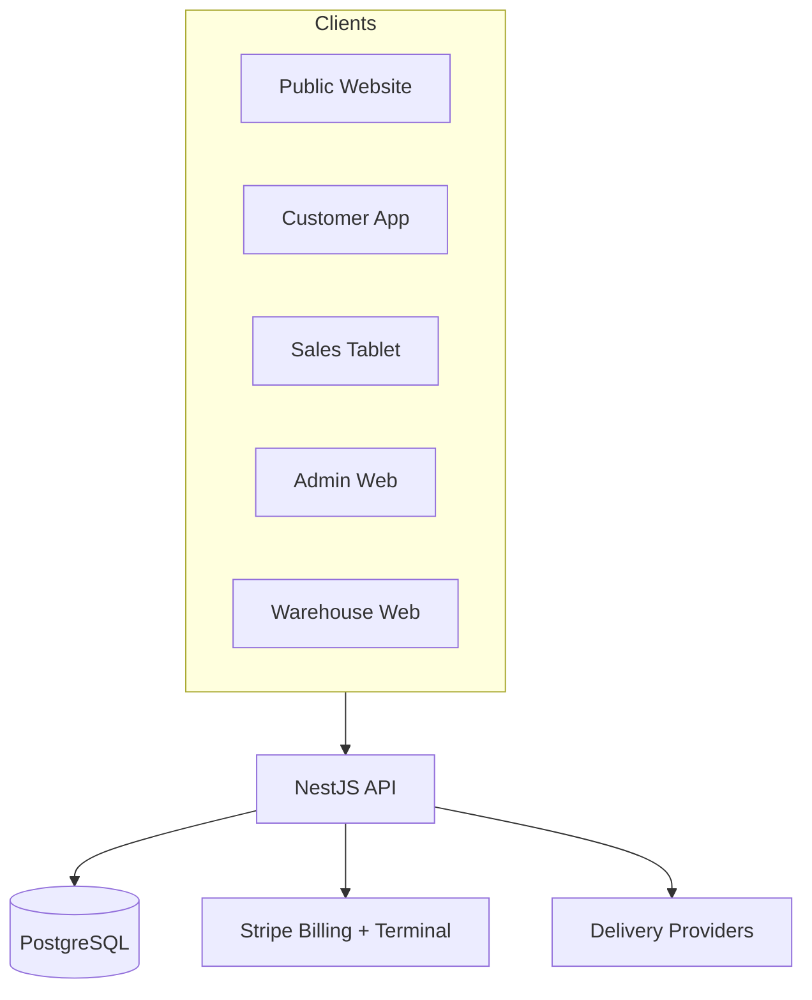

# ESSENTRA
## Complete Platform Design, Look & Feel, Wireframes & Development Plan (Canada)

> **Superseded for contracting:** Client name is **Essenvia**. Use **CAD $2,975** / 12-week quote and `Essenvia-Software-Development-Platform-Services-Agreement-CAD.md`. This file keeps the earlier **$4,905** Essentra estimate.

**Prepared for:** Josh and the Essentra team  
**Prepared by:** V, Founder, IIDATECH  
**Date:** October 5, 2026  
**Confidential.** For Essentra review and approval.

---

## Document control

| Item | Detail |
|------|--------|
| Version | 1.0 — Design & architecture approval package |
| Currency | All amounts **Canadian dollars (CAD)** unless noted |
| FX basis | **1 USD = 1.4246 CAD** (Bank of Canada daily noon rate, **October 1, 2026**, series FXUSDCAD) |
| USD source | IIDATECH proposal dated October 1, 2026 (USD figures converted and rounded for invoicing clarity) |
| Legal | Subscription, privacy, and policy pages use **placeholders** until Essentra counsel approves final wording |
| Interactive wireframes | Run locally: `npm run dev` → `/wireframes` |

---

## Executive summary

Essentra is a **subscription-based household essentials delivery company** operating in **Canada**. Customers describe the brands and quantities they already use; Essentra assembles a customized monthly box and delivers it on a recurring schedule. Customers see **one simple monthly price**—never wholesale costs, credits, or per-item surcharges.

This document integrates:

1. Essentra’s business and experience requirements (customer, salesperson, admin, warehouse).
2. IIDATECH’s proposed unified platform architecture and phased delivery.
3. **Canadian market context** (competitors, CAD pricing, data residency).
4. Look & feel direction, page inventory, journeys, database outline, security, hosting, phases, and **CAD investment estimates**.
5. Pointers to **clickable wireframes** in this repository.

**Recommendation before full build:** Approve Phase 0 (design, data model, business-rules sheet, fixed CAD quote) plus Growth Foundation (brand, research, GTM).

---

## Final principle (north star)

> Tell us about your household → choose the products and brands you use → we determine the appropriate Essentra package → you see **one monthly price** → we deliver automatically → preferences stay saved until you change them.

Everything behind the scenes may be sophisticated. Everything the customer sees must stay simple.

---

## Look & feel — Essentra brand system

### Personality

| We are | We are not |
|--------|------------|
| Modern, premium, clean, trustworthy | Dropship discount aesthetic |
| Professional, family-friendly, simple | Complicated ecommerce catalog |
| Mobile-first national consumer brand | Coupon site, popups, fake urgency |

### Colour palette

| Token | Hex | Usage |
|-------|-----|--------|
| Essentra Forest | `#1B4332` | Primary brand, headers, primary buttons |
| Essentra Sage | `#40916C` | Accents, success, links |
| Essentra Mint | `#D8F3DC` | Soft backgrounds, chips |
| Warm Canvas | `#FAFAF8` | Page background |
| Charcoal | `#1A1A1A` | Body text |
| Slate | `#64748B` | Secondary text |
| Border | `#E2E8F0` | Dividers, cards |
| Alert | `#B45309` | Warnings (failed payment, cut-off) |

### Typography

- **Display / marketing:** *Fraunces* or *Source Serif 4* — warmth and trust.
- **UI / app:** *DM Sans* or *Inter* — clarity at small sizes on mobile.
- **Hierarchy:** Hero 40–48px mobile / 56px desktop; section titles 28–32px; body 16–18px; minimum tap targets 44px.

### Imagery

- Realistic **Essentra delivery box** with recognizable national-brand products (admin-managed catalog, not hard-coded).
- Lifestyle: Canadian homes, diverse families, doorstep delivery.
- No stock “warehouse pallet” or cluttered product grids on the homepage.

### UI components

- Rounded cards (12–16px radius), generous whitespace, single primary CTA per screen in funnels.
- Progress bar on **Build My Essentra Box** (Steps 1–5 + result).
- Trust row: secure payment (Stripe), cancel/skip language, Canadian delivery.

**Live preview:** `/` (marketing shell) and `/wireframes` (lo-fi flows).

---

## Canadian subscription & delivery competitors

These are **market references** for positioning and pricing context—not design templates. Verify offers before external use.

| Competitor | Website | Model | Typical price (CAD) | What Essentra learns | Where Essentra differs |
|------------|---------|--------|---------------------|----------------------|-------------------------|
| **The Sustainable Home Box** (The Happy Box) | [thehappybox.ca](https://thehappybox.ca/products/sustainable-home-box) | Curated home essentials subscription | **~$99/box** (5–7 items); larger tiers available | Eco positioning, Canadian shipping | Essentra: **national brands**, full household plan, **one flat monthly price** |
| **Simply Canadian** | [simplycanadianbox.com](https://www.simplycanadianbox.com/) | Quarterly lifestyle/home box | **~$99/quarter** auto-renew | Seasonal cadence, small-business story | Essentra: **monthly essentials**, not seasonal surprise box |
| **The Spruce Box Co.** | [thesprucebox.ca](https://thesprucebox.ca/) | Quarterly curated home edit | **~$85.50/quarter** subscribed (~$95 single) | Value framing ($95–$110 retail value) | Essentra: predictable **replenishment**, not quarterly decor |
| **S&I Seasonal Refresh Box** (Simone & Ivy) | [simoneandivy.ca](https://simoneandivy.ca/collections/s-i-seasonal-home-refresh-box) | Quarterly home decor | **~$225/quarter** (promotional pricing varies) | Premium quarterly unboxing | Essentra: **consumables**, monthly delivery |
| **Well.ca** | [well.ca](https://well.ca) | Broad catalog + delivery (Canada) | Varies by cart | Trust in Canadian household delivery | Essentra: **no cart-building**; guided box + one price |
| **Amazon Subscribe & Save** (Canada) | [amazon.ca](https://www.amazon.ca) | Auto-replenish per SKU | Varies | Convenience, huge selection | Essentra: **curated household package**, single price |
| **Grove Collaborative** | [grove.co](https://grove.co) | Subscription essentials (US-primary; reference) | USD plans | Guided subscription UX | Essentra: **recognizable national brands**, Canada-first ops |
| **HelloFresh** | [hellofresh.ca](https://www.hellofresh.ca) | Meal kit subscription | Per serving/meal | Step-by-step plan builder, strong checkout | Essentra applies same **guided simplicity** to household goods |

---

## International reference competitors (non-Canadian)

Useful for UX patterns only; pricing below converted to CAD at **1.4246** for comparison workshops.

| Reference | Notes |
|-----------|--------|
| Blueland | Premium single-brand refill UX |
| Thrive Market | Membership + catalog |
| Dollar Shave Club | Simple tiered subscriptions |
| Walmart / Costco / Instacart | Convenience baseline |

---

## Essentra subscription plans (CAD)

Original USD list prices from requirements: **US$84.99 / US$94.99 / US$104.99** per month + applicable tax.

| Plan (working name) | USD (reference) | CAD (converted) | Customer-facing (recommended launch) |
|---------------------|-----------------|-----------------|--------------------------------------|
| Essentra Essential | $84.99 | **$121.06** | **$120.99/mo** + tax |
| Essentra Family | $94.99 | **$135.32** | **$134.99/mo** + tax |
| Essentra Plus | $104.99 | **$149.57** | **$149.99/mo** + tax |

**Admin-configurable:** plan names, public prices, internal wholesale-cost thresholds, and eligibility rules must be editable in the admin dashboard without code changes.

### How packages work (internal engine)

Packages are **not** “small/medium/large everything.” Each household gets different quantities per category; the backend sums **versioned wholesale costs** for the basket and maps to the qualifying plan using **adjustable thresholds**.

**SKU fields (admin-managed):** category, brand, product name, SKU, UPC, size, count, supplier, wholesale cost (RBAC-protected), customer description, image, inventory, active flag, substitutes, package eligibility.

**Customer sees:** one plan name + one monthly price + box contents (brands/sizes/qty)—never unit wholesale costs.

---

## Core product categories (initial ~10)

1. Laundry detergent  
2. Toilet paper  
3. Paper towels  
4. Dishwasher pods  
5. Dish soap  
6. Large garbage bags  
7. Kitchen/small garbage bags  
8. Fabric softener  
9. All-purpose / multi-surface cleaner  
10. Disinfecting wipes  

Categories are add/remove capable in admin.

---

## Website page map

| Page | Purpose |
|------|---------|
| Home | Hero, 3 steps, plans, categories, brands, benefits, FAQ, CTA |
| How It Works | Expanded journey + delivery/billing simplicity |
| Build My Essentra Box | Guided questionnaire → package result |
| Our Products | Categories and brand story (not full catalog shop) |
| Plans & Pricing | Three plans, one-price promise |
| Why Essentra | Time savings, recognized brands, customization |
| About Essentra | Company story |
| FAQ | Support deflection |
| Contact / Support | Form + hours |
| Customer Login | Magic link / password |
| Customer Dashboard | Box, subscription, delivery, account, payments, history |
| Legal (placeholders) | Terms, Subscription Terms, Privacy, Shipping, Refunds, Cancellation, Accessibility |

**Wireframe routes:** see `/wireframes` index in the app.

---

## Customer journey (online)

**Goal:** landing → paid subscription in **~3 minutes**, ~6 decision screens, progress visible.

1. **Landing** — “Your household essentials. Delivered automatically.” → **Build My Essentra Box** / **See How It Works**  
2. **Household** — 1, 2, 3, 4, 5+  
3. **Laundry** — brand, format (liquid/pods), consumption  
4. **Paper products** — TP & paper towels preferences + quantities  
5. **Kitchen** — pods, dish soap, bag sizes  
6. **Cleaning** — softener, cleaner, wipes  
7. **Your Essentra Package** — contents, plan, **one monthly CAD price**, first delivery estimate → **Start My Subscription**  
8. **Checkout** — contact, Canadian address (province, postal code), review, Stripe, consent  
9. **Confirmation** — magic-link account, receipt  
10. **Account** — skip, pause, swap (within configurable cut-off rules)

**Attribution:** rep QR / campaign params stored on subscription.

---

## Salesperson journey (tablet)

**Flow:** COMPARE → CUSTOMIZE → PACKAGE → CUSTOMER INFO → AGREEMENT → PAYMENT → SUBSCRIPTION

- Secure rep login (MFA optional, admin-controlled)  
- Same customization engine as web + **retail comparison** (verified data only)  
- Stripe Terminal tap/chip → token for recurring billing  
- Auto-create: account, subscription, first order, consent record, rep attribution  
- Offline-capable steps 2–4 with sync  

**Mobile app recommendation:** **One React Native (Expo) app** with **role-based UI** (customer vs sales rep). Separate apps duplicate auth, releases, and API contracts. Warehouse/admin remain web-first.

---

## Admin dashboard structure

**Roles:** Customer · Sales Rep · Warehouse · Customer Service · Manager · Administrator/Owner  

**Modules:**

- Catalog & costs (wholesale: management only)  
- Packages & internal thresholds  
- Customers & subscriptions  
- Orders & fulfillment  
- Inventory & substitutes  
- Delivery zones & schedules  
- Reps, territories, commissions  
- Payments, refunds, failed payments  
- Promotions, content, FAQs  
- Analytics & audit log  

---

## Technology stack

| Layer | Choice | Rationale |
|-------|--------|-----------|
| Public site + customer dashboard | **Next.js** (React, SSR/SEO) | Fast marketing site + authenticated account |
| Backend API | **NestJS** (TypeScript), versioned REST | Modular monolith; clear domains |
| Database | **PostgreSQL** (managed, AWS Canada) | Single source of truth, audit, cost versioning |
| Auth | NestJS-native: Argon2, magic links, MFA for admin | Credentials in your DB; RBAC |
| Mobile | **Expo / React Native** | One codebase, role-based shells |
| Payments | **Stripe Billing** + **Stripe Terminal** | PCI scope minimized; no raw PAN storage |
| Delivery | Provider-agnostic module | Own fleet + third parties |
| Hosting | **AWS ca-central-1** | Canadian data residency; dev/staging/prod |
| Domain | Essentra-owned registrar (e.g. Namecheap) | DNS control |

### Architecture diagram

---

## Database architecture (core groups)

**People:** users, roles, customers/households, addresses, sales_reps, territories  

**Catalog:** categories, brands, products, skus, supplier_costs (versioned), substitutes  

**Packaging:** packages, package_thresholds, basket_rules  

**Billing:** subscriptions, subscription_items, invoices, payments, payment_methods (provider refs)  

**Fulfillment:** orders, order_items, inventory, reservations, warehouse_locations  

**Delivery:** zones, schedules, deliveries, tracking  

**Compliance:** consents, agreements, attribution, audit_log  

**Chain:** customer → subscription (locked price, cost snapshot, source/rep) → orders → deliveries  

---

## Subscription & billing logic (defaults — all admin-configurable)

| Topic | Default policy |
|-------|----------------|
| Statuses | pending, active, paused, past_due, cancelled |
| Billing | Charge **3 days before ship**; changes until cut-off |
| Skip | Skips one delivery + one charge; price lock retained |
| Pause | Up to **3 months**, auto-resume with reminder |
| Failed payment | Retry days 1, 3, 5 + email/SMS; past_due → cancel after **14 days** if unpaid |
| Plan change | Applies next cycle at new public price |
| Cancel | Offer pause/skip first; win-back flow after cancel |

---

## Security & compliance

- TLS everywhere; encryption at rest for DB and backups  
- RBAC; wholesale costs restricted to authorized roles  
- Audit log for sensitive admin actions  
- No raw card data; Stripe Customer/PaymentMethod IDs only  
- Secrets in vault (not source code)  
- Separate dev / staging / production  
- Pre-launch penetration test (quoted separately)  

### Backup & recovery (targets)

- Daily automated backups, PITR  
- Cross-region backup copies  
- RPO ~15 minutes, RTO ~4 hours (validated restore tests)  

---

## Inventory & forecasting (V1 + roadmap)

**V1:** SKU on-hand, reserved, available, reorder threshold, location, substitutes  

**Phase 2:** 30-day demand forecast from active subscriptions (units by SKU for purchasing)

---

## Fulfillment & delivery statuses

New → Payment Confirmed → Ready to Pick → Picking → Packed → Ready for Delivery → Out for Delivery → Delivered → Delivery Exception/Failed  

Future: barcode scanning at pick/pack.

---

## Analytics (admin)

Active/new subscribers, MRR, ARPU, plan mix, sales by rep/territory, cancellations, retention/churn, failed payments, refunds, orders due, SKU demand, inventory requirements, brand popularity.

**Retention by rep** is a first-class metric for commissions and coaching.

---

## Development phases (technical)

| Phase | Weeks | Outcome |
|-------|-------|---------|
| **0** Discovery & design | 1–3 | Approved UI, wireframes, ERD, business-rules sheet, **fixed CAD quote** |
| **1** Foundation | 4 | Auth, roles, catalog/SKU admin, package engine |
| **2** Customer web | 5–7 | Site, Build My Box, checkout, Stripe Billing, accounts |
| **3** Operations | 8–9 | Orders, inventory, fulfillment, zones, notifications |
| **4** Sales | 10 | Rep tablet flow, retail comparison, Terminal, attribution |
| **5** Admin & analytics | 11 | Dashboards, retention, forecasting |
| **6** Customer app | 12–13 | Expo app (account + notifications) |
| **7** Launch & hardening | 14–15 | Load test, pilot territory, fixes |

**Pilot territory:** approximately week 16; **latest ~week 20** allowing approvals and content/legal sign-off.

*Calendar week ranges describe sequencing and dependency depth—not calendar promises for human teams.*

---

## Investment — platform build (CAD)

Converted from USD proposal using **× 1.4246**, rounded to practical invoicing amounts.

| Phase | USD (reference) | CAD (converted) | **CAD (quoted)** | Payable |
|-------|-----------------|-----------------|------------------|---------|
| 0 Discovery & design | $200 | $284.92 | **$285** | On approval |
| 1 Foundation | $300 | $427.38 | **$425** | Start of phase |
| 2 Customer web | $1,500 | $2,136.90 | **$2,135** | Start of phase |
| 3 Operations | $300 | $427.38 | **$425** | Start of phase |
| 4 Sales | $200 | $284.92 | **$285** | Start of phase |
| 5 Admin & analytics | $500 | $712.30 | **$710** | Start of phase |
| 6 Customer app | $250 | $356.15 | **$355** | Start of phase |
| 7 Launch & hardening | $200 | $284.92 | **$285** | Start of phase |
| **Total** | **$3,450** | **$4,914.87** | **$4,905** | Full system |

Estimates become **fixed price** at end of Phase 0.  

**Not included:** tablets/card readers, legal review, supplier contracts, third-party penetration test, **HST/GST** on IIDATECH invoices where applicable, Stripe fees, AWS spend.

### Estimated monthly run cost (CAD)

USD reference **$700–$900/mo** → **~$995–$1,285/mo** at 1.4246 (hosting, email/SMS infra, monitoring)—excluding payment processing and taxes.

---

## Growth, marketing & automation (CAD)

### A. Foundation (one-time)

| Workstream | USD (ref.) | CAD (quoted) |
|------------|------------|--------------|
| Brand & identity | $600–850 | **$855–$1,210** |
| Market & competitor research (Canada-focused) | $250 | **$355** |
| Go-to-market & 12-month plan | $250 | **$355** |
| **Bundle reference** | $1,100 | **~$1,565** |

### B. Always-on (monthly)

| Workstream | USD (ref.) | CAD (quoted) |
|------------|------------|--------------|
| Social media management | $500/mo | **$710/mo** |
| SEO & content | $70/mo | **$100/mo** |
| Paid acquisition management | $100/mo + ad spend | **$140/mo** + ad spend |

**Reference bundle:** $670/mo USD → **~$955/mo CAD**

### C. Conversion & automation (one-time)

| Workstream | USD (ref.) | CAD (quoted) |
|------------|------------|--------------|
| Lifecycle email/SMS flows | Included in Phases 2–3 | — |
| Operations automation alerts | $100 | **$140** |
| Support + AI assistant setup | $100 | **$140** |

### D. Sales enablement & launch

Quoted after Phase 0 (scripts, comparison sheets, training, territory launch).

---

## Wireframe index (interactive)

| ID | Screen | Route |
|----|--------|-------|
| WF-01 | Homepage | `/wireframes/home` |
| WF-02 | How It Works | `/wireframes/how-it-works` |
| WF-03–07 | Build My Box steps 1–5 + result | `/wireframes/build/step-1` … `step-5`, `/wireframes/build/result` |
| WF-08 | Checkout | `/wireframes/checkout` |
| WF-09 | Customer dashboard | `/wireframes/account` |
| WF-10 | Sales rep flow | `/wireframes/sales` |
| WF-11 | Admin overview | `/wireframes/admin` |
| WF-12 | Plans & pricing | `/wireframes/plans` |

---

## Risks & mitigations

| Risk | Mitigation |
|------|------------|
| Thin margins on national brands | Cost versioning, threshold alerts, admin margin reports |
| Supplier access | Authorized distributors; catalog fully configurable |
| Door-to-door regulations (Canada) | Cooling-off, written consent capture; legal review |
| Rep quality | Commission tied to 60/90-day retention |
| Payment failure | Retries + clear statuses |
| Scope creep | V1 limited to fundamentals per “What not to build yet” |

---

## What not to build in V1

Loyalty points, complex credits, AI recommendations, route optimization, marketplace catalog, heavy warehouse automation, unauthorized price scraping.

---

## Approval

| Authorize | Name / Title | Date |
|-----------|--------------|------|
| Phase 0 platform design | | |
| Growth Foundation | | |

**Contact:** Vidhu, Founder, IIDATECH  

**Next step:** Sign **Master Service Agreement** (`docs/Essentra-Master-Service-Agreement-CAD.md`) and authorize Phase 0 + Growth Foundation to begin detailed UI production and fixed quoting.

---

*Exchange rate source: Bank of Canada FXUSDCAD daily noon rate, October 1, 2026 (1.4243) and October 2, 2026 (1.4246); document uses **1.4246** as the conversion factor for USD list prices in the October 1 proposal.*
